# App Windows

## Sutta Search

<a href="/images/sutta-search-results-tab-screenshot.png" target="_blank">
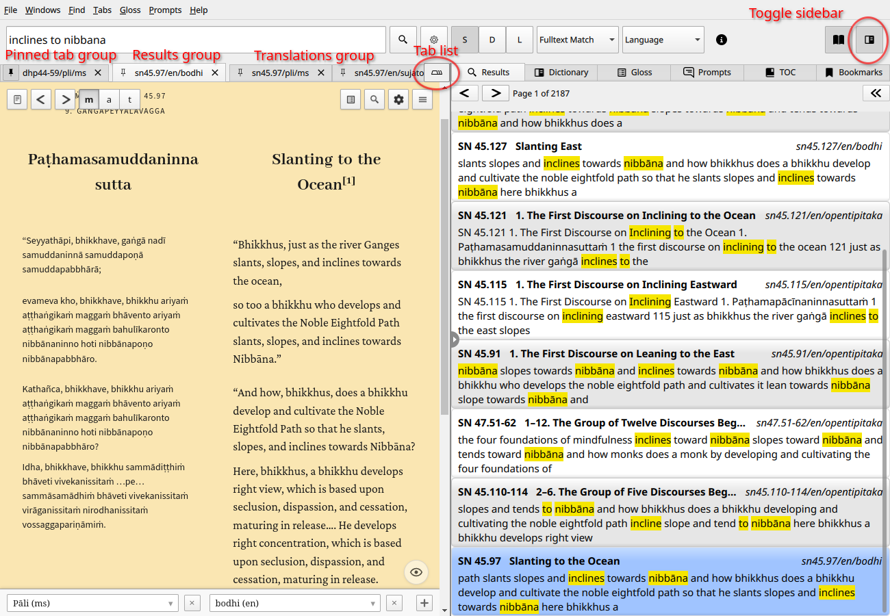
</a>

## Search Result Filtering

<a href="/images/advanced-search-options.png" target="_blank">
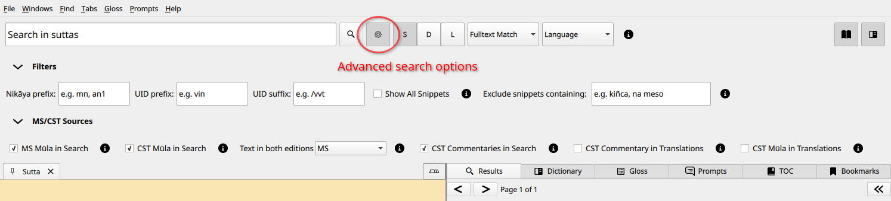
</a>

## Gloss Tab

Select a passage in the reader panel and click the Gloss icon:

<a href="/images/gloss-tab-word-in-sentence-dhp44-45.png" target="_blank">
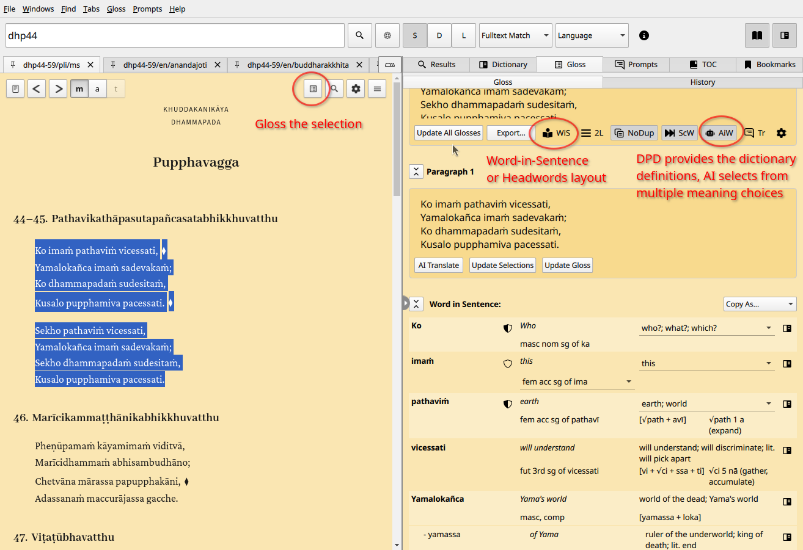
</a>

The default is two rows per word but there is an option for a one row layout. The previous more simple “Headwords” layout
can be toggled.

It exports to a number of formats such as DOCX. The same glossing task can be done with [the simsapa CLI](cli-localhost-api.md) as well.

<a href="/images/gloss-export-docx-dhp44-45.png" target="_blank">
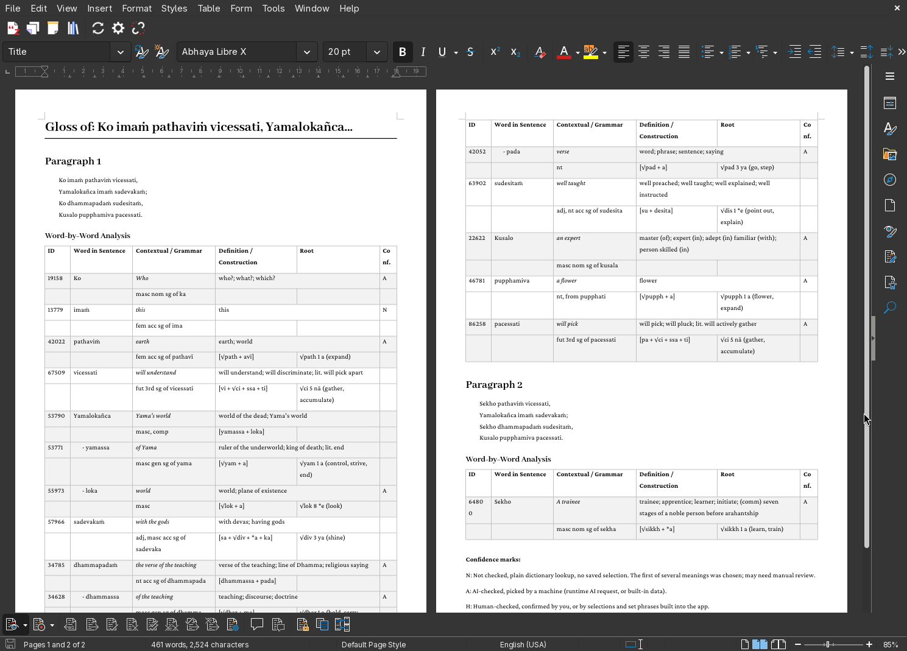
</a>

## Reading Layout Display Settings

<a href="/images/reading-layout-display-settings.png" target="_blank">
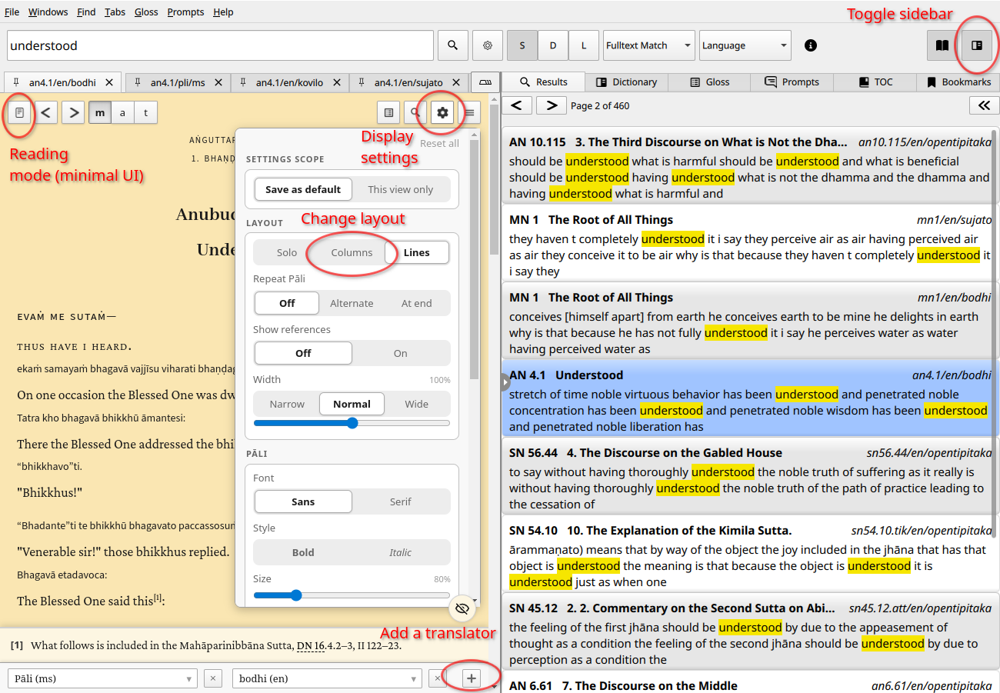
</a>


<a href="/images/reading-mode-three-columns-an4-1.png" target="_blank">
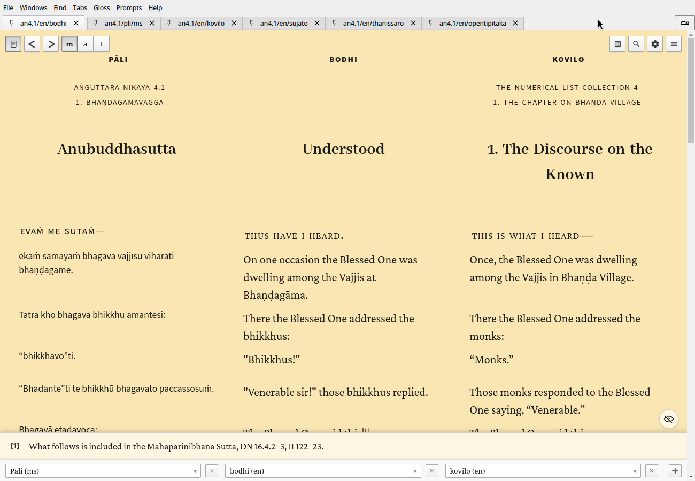
</a>

## Sutta Navigation

<a href="/images/sutta-navigation.png" target="_blank">
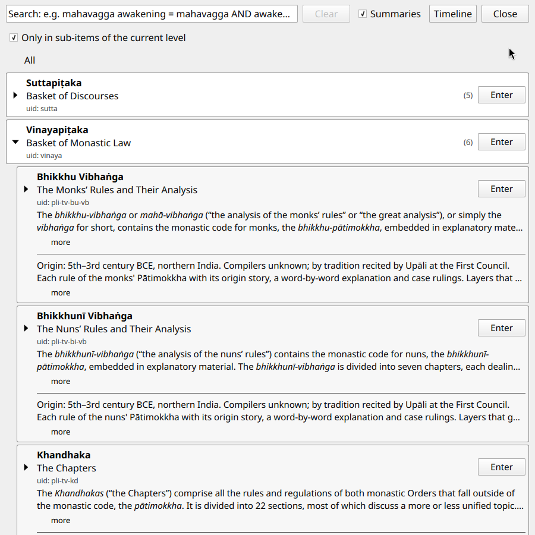
</a>

## Topic Index

[CIPS Topic Index](https://index.readingfaithfully.org/) (Comprehensive Index of Pāli Suttas) by Ven. Khemaratana

<a href="/images/topic-index-feeling.png" target="_blank">
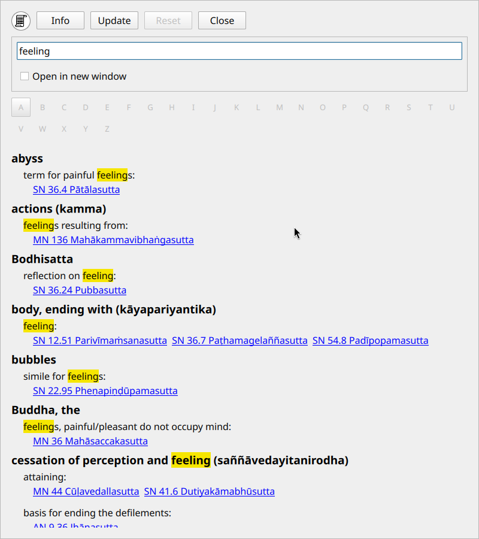
</a>

## Sutta Languages

Translations from SuttaCentral

<a href="/images/sutta-languages.png" target="_blank">
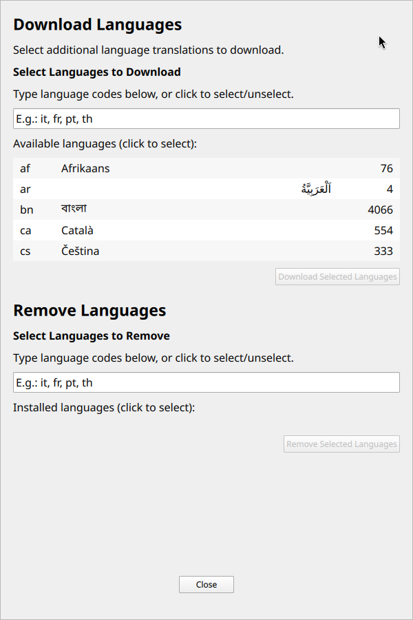
</a>

## CLI with Agents

An npm package provides cli interface to Simsapa for humans and AI agents,
which uses the same database as the GUI app.

```
npm install -g @simsapa/cli
```

More info: [Command Line and Localhost API](cli-localhost-api.md)

<!-- ## Dictionary Search -->

<!-- <a href="/images/dictionary-search-parikkhita-screenshot.png" target="_blank"> -->
<!-- 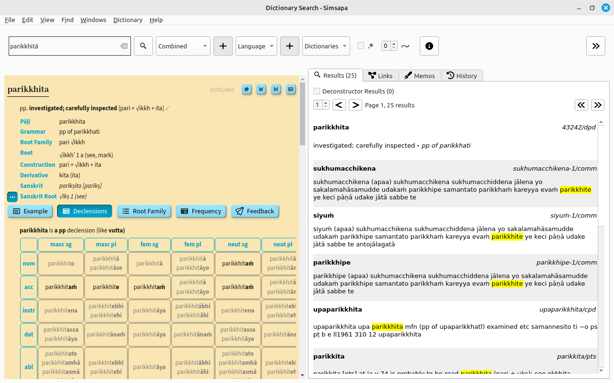 -->
<!-- </a> -->

## Dictionary Import

In **Windows > Dictionaries** additional dictionaries can be imported.
The selections automate importing from [digitalpalidictionary/other-dictionaries](https://github.com/digitalpalidictionary/other-dictionaries/releases/),
but custom StarDict / GoldenDict format .zip dictionary files can also be imported.

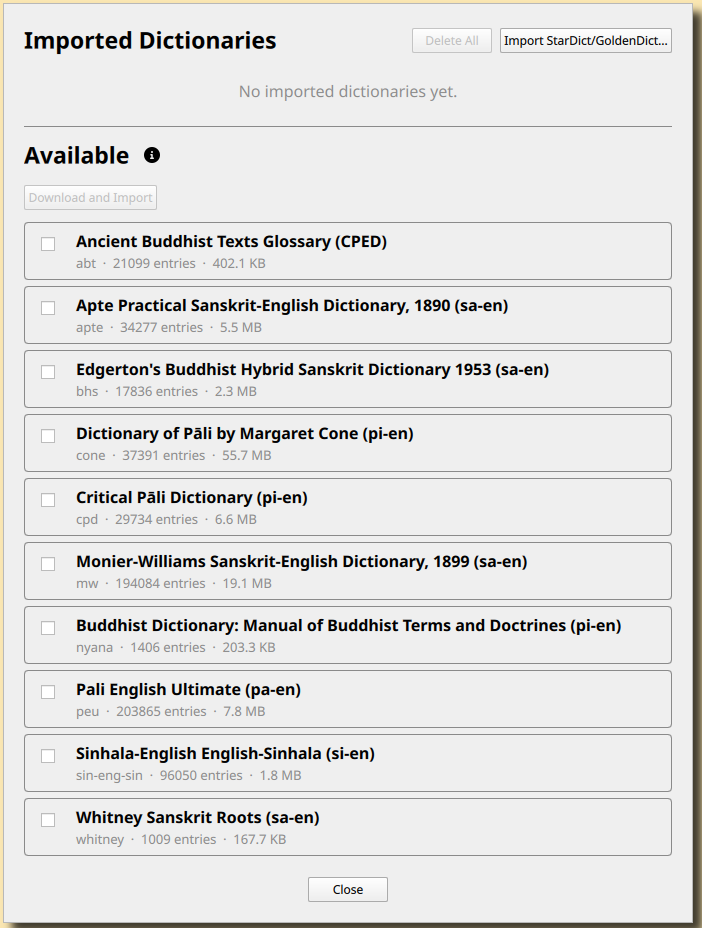

<!-- ## Word Lookup -->

<!-- <a href="/images/word-lookup-cittanupassi-screenshot.png" target="_blank"> -->
<!-- 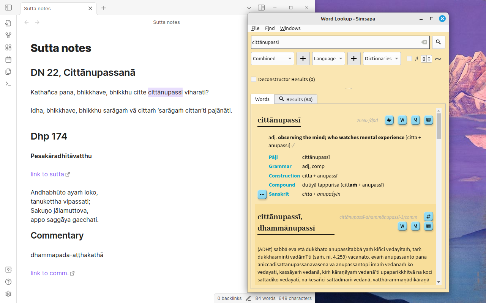 -->
<!-- </a> -->

<!-- ## Bookmarks -->

<!-- <a href="/images/create-bookmark-mn143-screenshot.png" target="_blank"> -->
<!-- 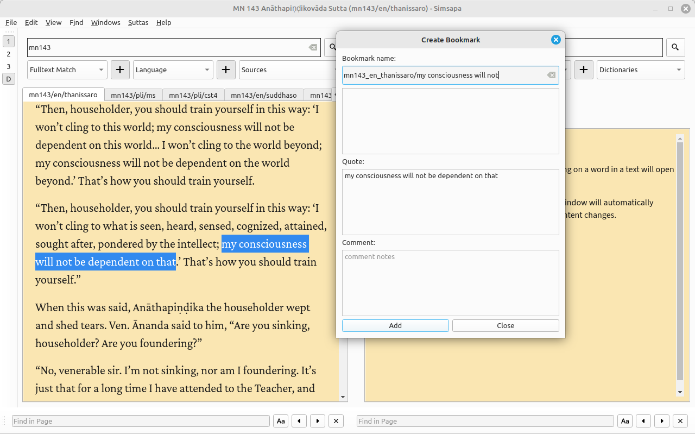 -->
<!-- </a> -->

<!-- <a href="/images/bookmarks-browser-mn143-screenshot.png" target="_blank"> -->
<!-- 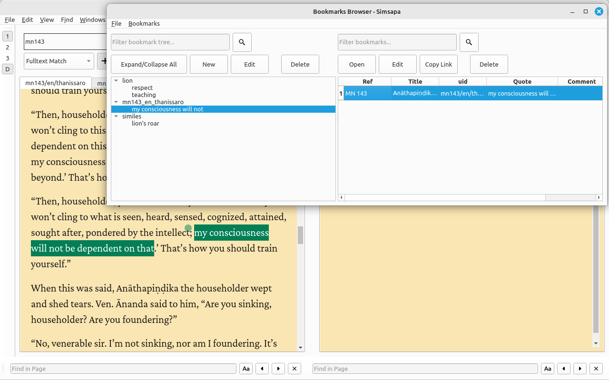 -->
<!-- </a> -->

<!-- ## Library / Ebook Reader -->

<!-- <a href="/images/ebook-reader-open-epub-screenshot.png" target="_blank"> -->
<!-- 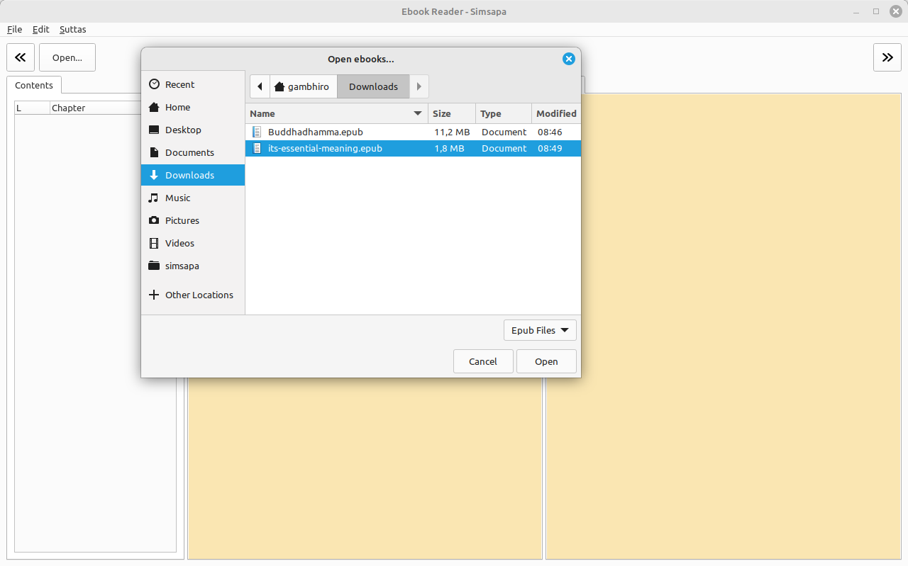 -->
<!-- </a> -->

<!-- <a href="/images/ebook-reader-essential-meaning-sankhara-screenshot.png" target="_blank"> -->
<!-- 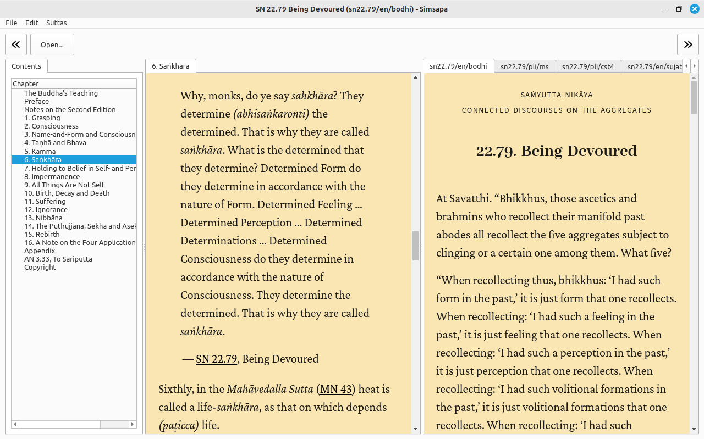 -->
<!-- </a> -->

