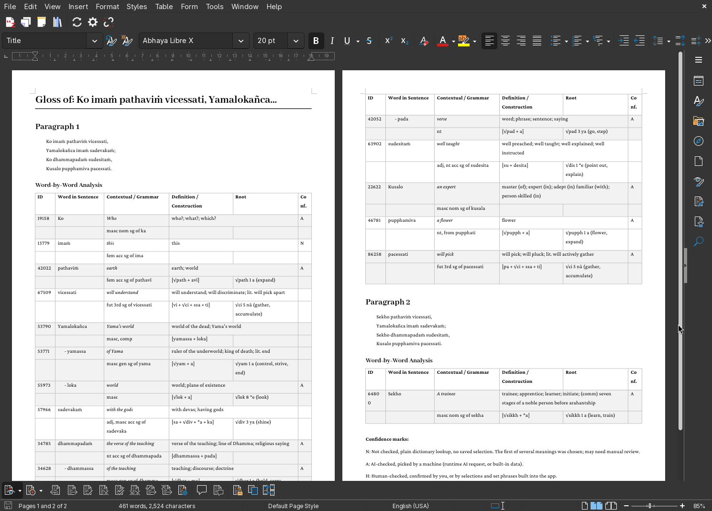
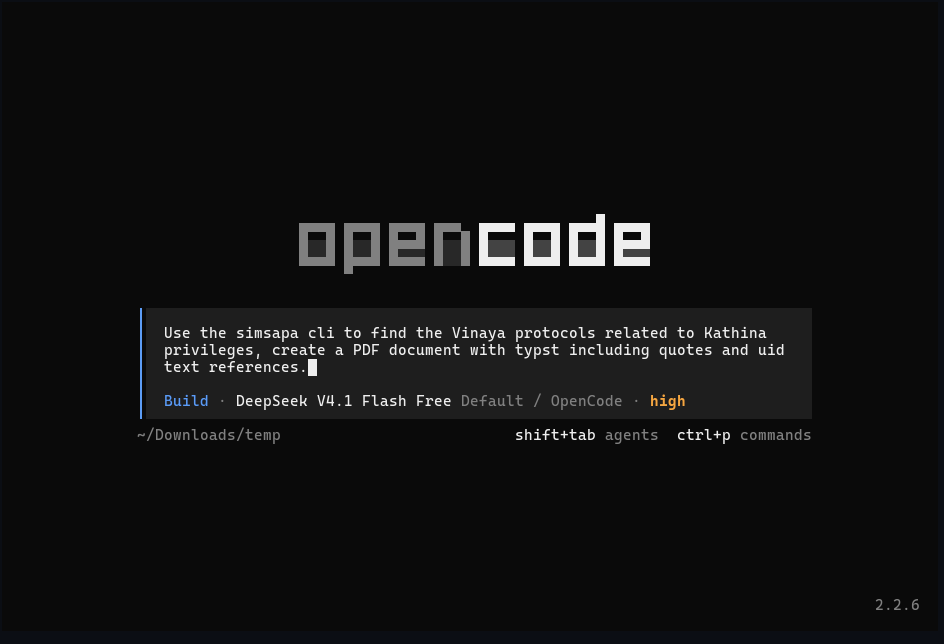

# Simsapa Command Line and Localhost API

An npm package provides cli interface to Simsapa for humans and AI agents,
which uses the same database as the GUI app.

```
npm install -g @simsapa/cli
```

- `simsapa health` checks status.
- `simsapa install-skill` sets up skill files so agents know how to use it.
- See `simsapa help` for more.

It reads API keys from env variables e.g. `GEMINI_API_KEY`

A glossing task as a cli command which saves the results to a DOCX file:

```
simsapa gloss \
        --model-name gemini-3.6-flash \
        --skip-common \
        --no-duplicates-globally \
        --no-translate \
        --format docx \
        --output gloss-dhp44-45.docx \
"Ko imaṁ pathaviṁ vicessati,
Yamalokañca imaṁ sadevakaṁ;
Ko dhammapadaṁ sudesitaṁ,
Kusalo pupphamiva pacessati.

Sekho pathaviṁ vicessati,
Yamalokañca imaṁ sadevakaṁ;
Sekho dhammapadaṁ sudesitaṁ,
Kusalo pupphamiva pacessati."
```

<a href="/images/gloss-export-docx-dhp44-45.png" target="_blank">

</a>

When the skill files are installed with `simsapa install-skill`,
agents such as [opencode.ai](https://opencode.ai/) can perform tasks and include quotes and references from the database, instead of the online posts the AI was trained on, or non-existing suttas being hallucinated by the AI.

Such as a Dhamma question:

```
Use the simsapa cli to research how the Buddha teaches anattā in his own words,
what specifically he means by it, how it is practised, and how it relates to
other key terms.
Create a PDF document with typst including verified quotes and sutta uid text references.
```

Or a Vinaya research topic:

```
Use the simsapa cli to find the Vinaya protocols related to Kathina privileges.
Create a PDF document with typst including verified quotes and sutta uid text references.
```



