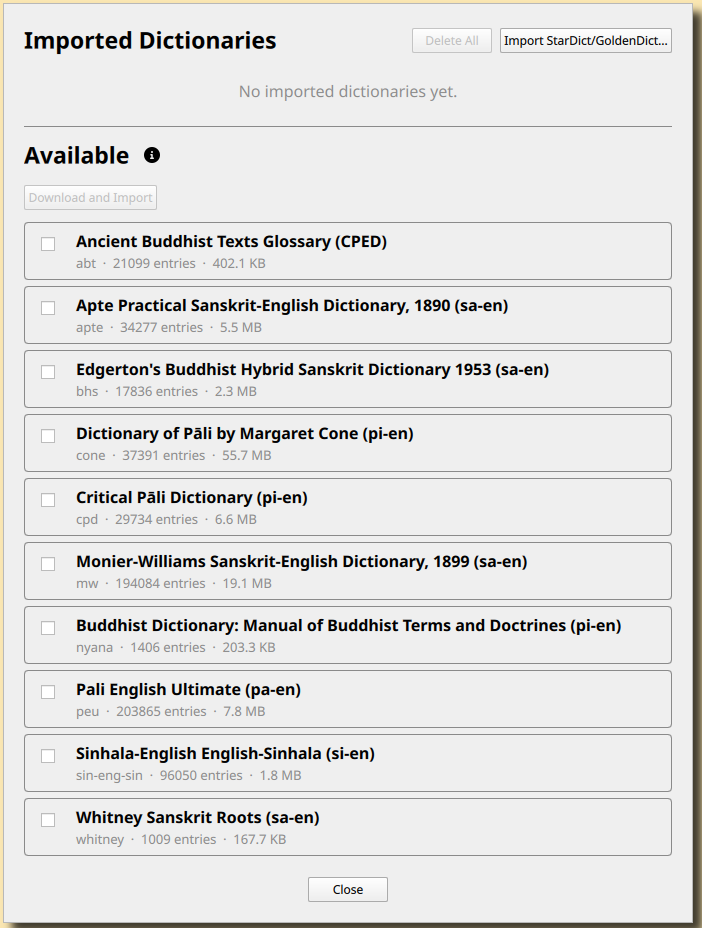

# Dhamma Texts Included in Simsapa

## Suttas

- [suttacentral.net](https://suttacentral.net/)
  - `pli` and `en` languages by default
  - other languages as optional downloads via `Windows > Sutta Languages...` menu
- [tipitaka.org](https://tipitaka.org/cst4) Chaṭṭha Saṅgāyana Tipiṭaka 4
- [dhammatalks.org](https://www.dhammatalks.org/) Translations by Aj Thanissaro
- [Dhamma Verses Commentary: A Revised Translation of the Dhammapada Aṭṭhakathā (Revised by Ānandajoti Bhikkhu, 2024)](https://ancient-buddhist-texts.net/English-Texts/Dhamma-Verses-Comm/)
- [The Birth Stories, Jātakatthavaṇṇanā (Revised by Ānandajoti Bhikkhu, 2023)](https://ancient-buddhist-texts.net/English-Texts/Jataka/)
- [tipitaka.net](https://www.tipitaka.net/tipitaka/dhp/) The Dhammapada: Verses and Stories Translated by Daw Mya Tin, M.A.
- [A Dhammapada for Contemplation](https://forestsangha.org/teachings/books/a-dhammapada-for-contemplation?language=English) by Ajahn Munindo
- [a-buddha-ujja.hu](https://a-buddha-ujja.hu/) Hungarian sutta translations
- [The Silent Sages of Old](https://archive.org/details/VenDenmarkNyanadipa) Translations by Bhante Nyanadipa
- [index.readingfaithfully.org](https://index.readingfaithfully.org/) Sutta Index of Topics
- [opentipitaka.org](https://www.opentipitaka.org/) English translation of the CST texts, produced by AI
- [patimokkha.jhana.info](https://patimokkha.jhana.info/)Bhikkhu Pāṭimokkha in Pāli-English, Ṭhānissaro Bhikkhu, 2008

## Dictionaries

- `DPD` Digital Pāḷi Dictionary [digitalpalidictionary.github.io](https://digitalpalidictionary.github.io/)
- `DPPN` Dictionary of Pāli Proper Names [ancient-buddhist-texts.net](https://ancient-buddhist-texts.net/Textual-Studies/DPPN/) (Revised by Ānandajoti Bhikkhu, June 2025)

In **Windows > Dictionaries** additional dictionaries can be imported.
The selections automate importing from [digitalpalidictionary/other-dictionaries](https://github.com/digitalpalidictionary/other-dictionaries/releases/),
but custom StarDict / GoldenDict format .zip dictionary files can also be imported.

## Reference Conversion

- [palistudies.blogspot.com](https://palistudies.blogspot.com) Learn Pali Language
- [github.com/dhammavinaya-tools/dhamma-vinaya-catalogue](https://github.com/dhammavinaya-tools/dhamma-vinaya-catalogue) Dhamma Vinaya Catalogue
