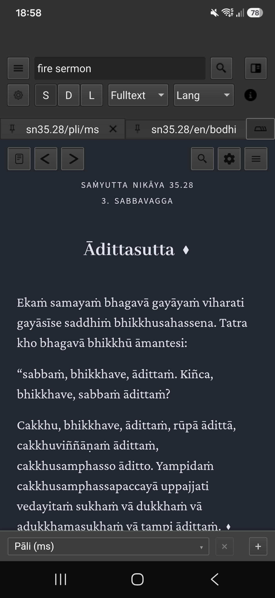

# Simsapa Dhamma Reader

A sutta reader and Pāli dictionary application.

Download the latest build from [Releases](https://github.com/simsapa/simsapa/releases/). On the first run, it downloads the application database and fulltext index.

After the database download, the application works completely offline.

## Screenshots

