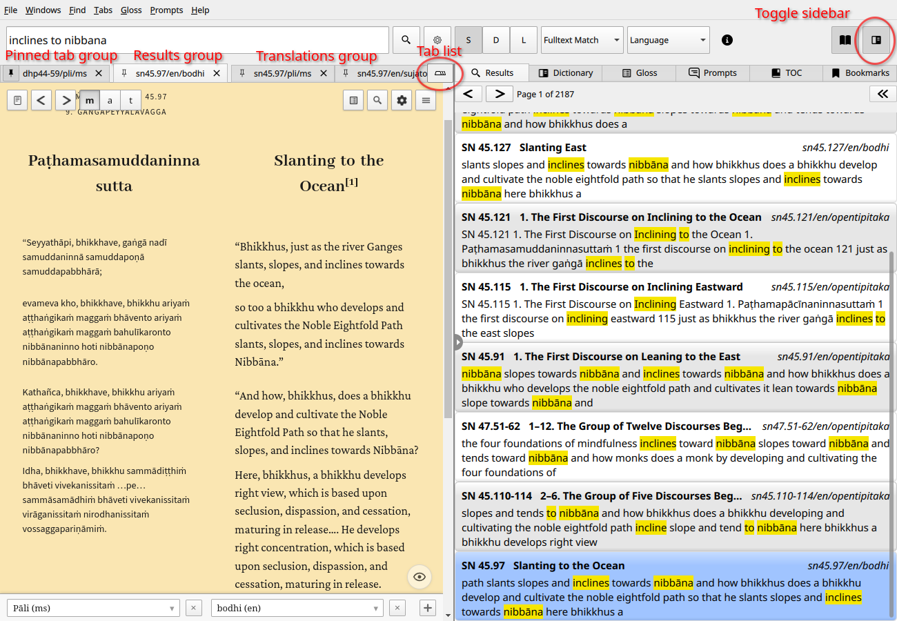
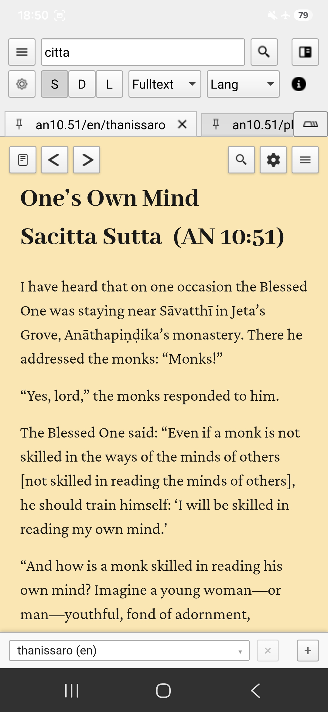

# Simsapa Dhamma Reader

A sutta reader and Pāli dictionary application. Feature highlights:

- [Fulltext search](https://simsapa.github.io/features/search-queries/) with Pāli declension matching
- Search result filtering options
- Integrates suttas with commentaries, dictionaries and a book library
- Line-by-line or side-by-side columns layout with multiple translations
- Pāli text gloss analysis with export formats
- [Extensions and plugins](https://github.com/simsapa/simsapa-extensions-and-plugins) for browsers and note taking app
- Command line interface (`@simsapa/cli` npm package) for humans and AI agents

Download from the [Releases](https://github.com/simsapa/simsapa/releases) page for Linux, MacOS, Windows.
For Android, install from from the [Play Store](https://play.google.com/store/apps/details?id=io.github.simsapa.app) 
or using the .apk download.

On the first run, it downloads the application database and fulltext index.
After the database download, the application works offline.

Installation guides: [Linux](install/linux.md) / [MacOS](install/macos.md) / [Windows](install/windows.md).

## Screenshots

