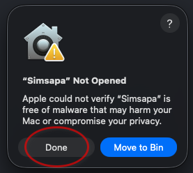
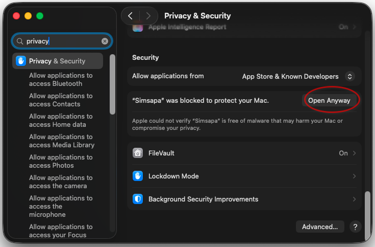
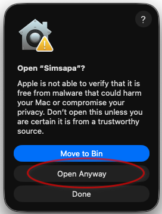

# Install on MacOS

Download the latest `.dmg` from [Releases](https://github.com/simsapa/simsapa/releases/).

Open the `.dmg` file, drag the Simsapa icon to Applications.

When starting the app, you will see a warning because the app is not signed, and MacOS can't verify the developer.

**Allow apps from third-party locations:**

Open System Settings > Security & Privacy > scroll down and click "Open Anyway"

Next to the message `"Simsapa" was blocked ...`, click `Open Anyway`.

Starting the app with the icon will ask again:

