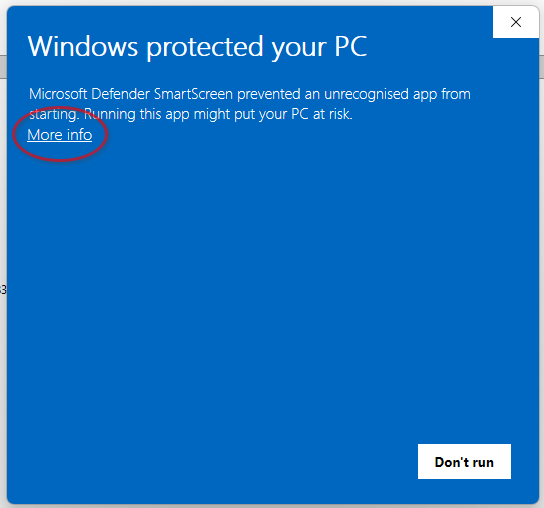
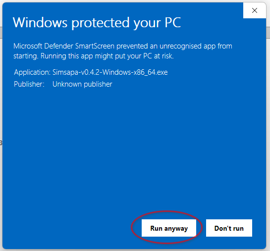

# Install on Windows

Download the latest Windows `.exe` from [Releases](https://github.com/simsapa/simsapa/releases/).

When starting the setup, you will see a warning because the app is not signed, and Windows can't verify the developer.

Click "More info"

Click "Run Anyway"

After the setup completes, start the application. When running it the first time, it offers to download the database.

